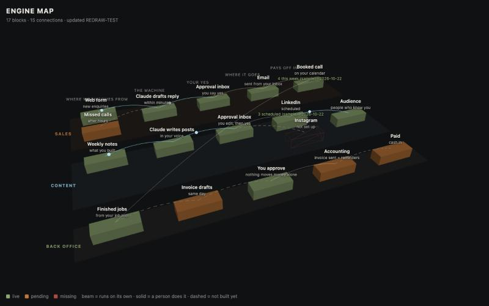

# Engine Map

Draw your whole business as one live 3D map, from a single JSON file that Claude Code keeps up to date.



Every channel, tool and account is a block. Every handoff is a line. A beam travels the lines that run on their own. When Claude Code edits `engine-map.json`, the map redraws within two seconds.

The point isn't the visual. It's being able to see in one look what runs by itself, what's waiting on a person, and what's missing.

## Run it

```bash
git clone https://github.com/mtbba8-afk/engine-map
cd engine-map
python3 -m http.server 8000
```

Open http://localhost:8000. Or see the sample live: https://mtbba8-afk.github.io/engine-map/ Drag to orbit, scroll to zoom. (Opening `index.html` directly won't work, because browsers block reading the JSON from a `file://` page.)

No build step, no dependencies. One HTML file and three.js from a CDN.

## Make it yours

Open Claude Code in this folder and give it this:

> Map my business as one JSON file, following the schema in engine-map.json: every channel, tool and account, where each one feeds, and its status. Ask me what you can't find. Mark anything you're unsure of as pending, not live.

Then keep the map open while you work. Each time Claude Code changes something in your business, ask it to update `engine-map.json` in the same step.

## The schema

| Field | What it is |
|---|---|
| `columns` | Left to right: where work comes from, the machine, the approval, where it goes, where it pays off. Rename them to fit. |
| `lanes` | One glass layer each: `key`, `label`, `col` (hex colour). |
| `nodes` | `id`, `lane`, `col` (column index), `row` (0, 0.5, 1…), `title`, `sub`, `status`, optional `span`, `num`, `numDate`. |
| `edges` | `[from, to, kind]`. `auto` runs on its own (beam), `manual` needs a person (solid), `pending` isn't built yet (dashed). |

## Three rules that keep it honest

1. **Every block has a status:** `live`, `pending` or `missing`. Missing is allowed. Pretending isn't.
2. **Every number has a date.** A `num` without a `numDate` doesn't go on the map.
3. **Nothing moves money or speaks for you on its own.** The approval column exists for a reason. If a line skips it, that's the first thing to fix.

The sample file is made up. Every name and number in it is a placeholder.

## Use your own file

`index.html?file=my-business.json` loads a different file from the same folder, so you can keep your real map out of git (add it to `.gitignore`).

## Credits

Built with [Claude Code](https://claude.com/claude-code). Rendering by [three.js](https://threejs.org).

By Mohamed Tounkara, [Tounkara Group](https://tounkaragroup.com). MIT licensed.
